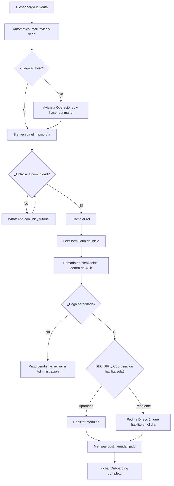

# Ejemplo de output · Constructor de SOP de Infonegocio

> Datos ficticios. Programa grupal de marketing para nutricionistas, 6 meses, vendido por llamada. El SOP sale después de una entrevista de 11 preguntas. Abajo del SOP, la fila para la librería y el resumen para el founder. Al final, una variante en formato corto para procesos simples.

---

# SOP · Onboarding de alumno nuevo (del pago al acceso completo) · Proceso

**Owner del proceso:** Coordinación de servicio · **Se dispara cuando:** el closer carga la venta en el formulario de ventas del CRM · **Frecuencia:** por evento (8 a 12 por mes)
**Meta de tiempo:** acceso a plataforma y comunidad, y llamada de bienvenida hecha, **dentro de las 48 h** de la venta · **Duración por ejecución:** 40 minutos (más la llamada) · **Herramientas:** CRM (formulario y tabla Alumnos), automatización (Zapier), mail del equipo, comunidad, plataforma de cursos, calendario de la coordinación, WhatsApp del negocio · **Última actualización:** 14/10 · **Estado:** Borrador · pendiente de aprobación

## Objetivo

Este SOP describe cómo dar de alta a un alumno nuevo para que tenga acceso, formulario de inicio y llamada de bienvenida **dentro de las 48 h** de la venta, sin que nadie tenga que preguntar en el grupo si ya entró.

## Antes de empezar

**Accesos que necesita el owner**

| Herramienta | Nivel | ¿Coordinación lo tiene hoy? |
|---|---|---|
| CRM, tabla Alumnos | Editor | Sí |
| Mail del equipo (bandeja de enviados) | Lectura y envío | Sí |
| Comunidad | Moderador (para cambiar roles) | Sí |
| Plataforma de cursos | Admin de miembros | ⚠ No: hoy solo entra la founder. Lo tiene que dar Dirección |
| Automatización (Zapier) | Lectura del historial | ⚠ No: la cuenta es de Operaciones. Lo tiene que dar Operaciones |

**Información a mano:** la nota de traspaso del closer en la ficha del alumno (qué compró, cuotas, qué se le prometió) y las respuestas del formulario de inicio.

**Recursos:** guion de la llamada de bienvenida [link a …] · presentación del programa [link a …] · tutorial "cómo entrar a la comunidad" [link a …].

## Decisiones pendientes

| Qué hay que decidir | Recomendación | Aprueba | Mientras tanto |
|---|---|---|---|
| ¿Coordinación habilita accesos en la plataforma sin pedir permiso? | Sí, si el pago figura acreditado en el CRM | Dirección | Coordinación le pasa a Dirección el alumno con el pago verificado, por el canal #servicio, y Dirección habilita en el día |
| ¿Qué pasa si el alumno no firma el contrato antes de la llamada? | La llamada se hace igual; se le pide fecha de firma y se sigue 2 veces por semana | Dirección | Se hace la llamada y se anota "contrato pendiente" en la ficha |

## Resumen de pasos

| Paso | Responsable / Plataforma | Tipo | Cuándo | Tarea | Objetivo |
|---|---|---|---|---|---|
| 1 | Closer | Manual | En la llamada de cierre | Mandar el link de la comunidad | Que el alumno salga de la llamada adentro |
| 2 | Closer | Manual | Al cortar la llamada | Cargar la venta en el formulario de ventas | Disparar el onboarding |
| 2.A | Zapier + mail del equipo | Automático | 2 min después del paso 2 | Mail de bienvenida con formulario, agenda y contrato | Que el alumno tenga todos los links |
| 2.B | Zapier + canal #nuevos-alumnos | Automático | 2 min después del paso 2 | Aviso interno de la venta | Que Coordinación se entere al instante |
| 2.C | Zapier + CRM | Automático | 2 min después del paso 2 | Crear la ficha del alumno | Tener el registro para el checklist |
| 3 | Coordinación de servicio | Manual | Al ver el aviso del 2.B | Mandar el mensaje de bienvenida | Primer contacto humano en el día |
| 4 | Coordinación de servicio | Manual | Cuando el alumno entra a la comunidad | Cambiar el rol del alumno en la comunidad | Que vea los canales de su programa |
| 5 | Coordinación de servicio | Manual | Antes de la llamada | Leer el formulario de inicio | Personalizar la llamada |
| 6 | Coordinación de servicio | Llamada | Dentro de las 48 h de la venta | Hacer la llamada de bienvenida | Accesos, contrato y programa claros |
| 7 | Coordinación de servicio | Manual | Al cortar la llamada | Habilitar los módulos del programa | Que pueda arrancar ese día |
| 8 | Coordinación de servicio | Manual | Al cortar la llamada | Mandar el mensaje post llamada y fijarlo | Que tenga todo en un solo lugar |
| 9 | Coordinación de servicio | Manual | Al cortar la llamada | Actualizar la ficha del alumno | Que todo el equipo vea el estado |

## Los pasos

### Paso 1 · Mandar el link de la comunidad
**Responsable / Plataforma:** Closer · **Tipo:** Manual · **Cuándo:** en la llamada de cierre, apenas confirma el pago
1. Mandá por WhatsApp el link de la comunidad con el mensaje "Link a la comunidad" (ver Mensajes al cliente).
**Objetivo:** que el alumno salga de la llamada adentro de la comunidad.
‼️ **Precauciones:** si al terminar tu día el alumno no entró, escribile de nuevo. Si no podés mandar el link, avisá por #servicio.

### Paso 2 · Cargar la venta en el formulario de ventas
**Responsable / Plataforma:** Closer · CRM · **Tipo:** Manual · **Cuándo:** al cortar la llamada
1. Abrí el formulario de ventas del CRM [link a …] y completá todos los campos, incluida la nota de traspaso.
2. Verificá en tu vista "Mis ventas" que la venta aparece.
**Objetivo:** disparar el onboarding: los pasos 2.A, 2.B y 2.C dependen de esta carga.
‼️ **Precauciones:** confirmale al alumno que le llegó el mail de bienvenida. Si no le llegó → que revise spam. Si sigue sin llegar y la venta está en tu vista → avisá a Coordinación para que lo reenvíe a mano. Si la venta no está en tu vista → cargala de nuevo.

### Paso 2.A · Mail de bienvenida
**Responsable / Plataforma:** Zapier + mail del equipo · **Tipo:** Automático · **Cuándo:** 2 minutos después del paso 2
- Manda el mail "Bienvenida" con: formulario de inicio, link de la comunidad, link para agendar la llamada de bienvenida, acceso a la plataforma y contrato.
**Objetivo:** que el alumno tenga todos los links para hacer su parte.
‼️ **Precauciones:** si llegó el aviso del 2.B, el mail tiene que estar en "Enviados" del mail del equipo. Si no está → mandalo a mano desde ahí con la plantilla y avisá a Operaciones: la automatización puede estar caída para todos. Confirmá con el alumno que el mail cargado es el correcto: es el error más común del paso 2.

### Paso 2.B · Aviso interno de la venta
**Responsable / Plataforma:** Zapier + canal #nuevos-alumnos · **Tipo:** Automático · **Cuándo:** 2 minutos después del paso 2
- Publica nombre, programa, teléfono y closer.
**Objetivo:** que Coordinación se entere al instante.
‼️ **Precauciones:** si el closer cargó la venta y el aviso no aparece en 10 minutos, el closer avisa a Operaciones.

### Paso 2.C · Crear la ficha del alumno
**Responsable / Plataforma:** Zapier + CRM · **Tipo:** Automático · **Cuándo:** 2 minutos después del paso 2
- Crea el registro en la tabla Alumnos con nombre, programa, teléfono y mail.
**Objetivo:** tener el registro para llevar el checklist. **Desde acá corren las 48 h.**
‼️ **Precauciones:** si hay aviso en #nuevos-alumnos pero no hay ficha, avisá a Operaciones y creala a mano.

### Paso 3 · Mandar el mensaje de bienvenida
**Responsable / Plataforma:** Coordinación de servicio · comunidad o WhatsApp · **Tipo:** Manual · **Cuándo:** al ver el aviso del 2.B, el mismo día
1. Buscá al alumno en el canal #presentaciones de la comunidad.
   - Si entró → mandale el mensaje "Bienvenida" por la comunidad.
   - Si no entró → mandáselo por WhatsApp, con el link de la comunidad y el tutorial.
2. Marcá en la ficha "Bienvenida enviada" con la fecha.
**Objetivo:** primer contacto humano en el día de la venta.
‼️ **Precauciones:** seguimiento diario hasta que agende la llamada; después, 2 veces por semana mientras falte algo.

### Paso 4 · Cambiar el rol del alumno en la comunidad
**Responsable / Plataforma:** Coordinación de servicio · comunidad · **Tipo:** Manual · **Cuándo:** cuando el alumno entra
1. Quitale el rol "Miembro" y asignale el rol de su programa.
2. Tildá "Comunidad" en la ficha.
**Objetivo:** que vea los canales y las clases de lo que compró, y no anuncios de otros programas.
‼️ **Precauciones:** si queda con los dos roles, recibe mensajes que no son para él y se confunde de canal.

### Paso 5 · Leer el formulario de inicio
**Responsable / Plataforma:** Coordinación de servicio · formularios · **Tipo:** Manual · **Cuándo:** antes de la llamada
1. Abrí las respuestas del formulario de inicio y anotá en la ficha su objetivo principal.
2. Elegí la ruta de módulos que corresponde a ese objetivo.
**Objetivo:** personalizar la llamada y la ruta.
‼️ **Precauciones:** si no completó el formulario, avisale que es obligatorio para la llamada. Si no lo completa antes, reagendá.

### Paso 6 · Hacer la llamada de bienvenida
**Responsable / Plataforma:** Coordinación de servicio · videollamada · **Tipo:** Llamada · **Cuándo:** dentro de las 48 h de la venta
1. Mandá el recordatorio con el link 15 minutos antes (mensaje "Recordatorio").
2. Seguí el guion: confirmá que está en la comunidad y en la plataforma, presentá el programa y su ruta, y preguntá cuándo se compromete a arrancar.
3. Si no firmó el contrato → pedile la fecha de firma. **[DECIDIR: qué pasa si no firma · recomiendo llamada igual y seguimiento · aprueba Dirección]**
**Objetivo:** que salga con accesos, contrato y programa claros.
‼️ **Precauciones:** si no se conecta, esperá 10 minutos, escribile y después llamalo. Si no prende la cámara, ofrecé reagendar.

### Paso 7 · Habilitar los módulos del programa
**Responsable / Plataforma:** Coordinación de servicio · plataforma de cursos · **Tipo:** Manual · **Cuándo:** al cortar la llamada
1. Verificá en la tabla Cobros del CRM que el primer pago figure acreditado.
2. Entrá a Miembros de la plataforma y habilitale los módulos de su programa. **[DECIDIR: Coordinación habilita sin pedir permiso · aprueba Dirección]** Mientras tanto: pasale el alumno a Dirección por #servicio y pedí que lo habilite en el día.
**Objetivo:** que pueda empezar ese mismo día.
‼️ **Precauciones:** sin pago acreditado, no se habilita: avisá a Administración.

### Paso 8 · Mandar el mensaje post llamada y fijarlo
**Responsable / Plataforma:** Coordinación de servicio · comunidad · **Tipo:** Manual · **Cuándo:** al cortar la llamada
1. Mandá el mensaje "Post llamada" con la presentación y su ruta.
2. Fijalo en el chat.
**Objetivo:** que tenga todo en un solo lugar y no vuelva a preguntar.

### Paso 9 · Actualizar la ficha del alumno
**Responsable / Plataforma:** Coordinación de servicio · CRM · **Tipo:** Manual · **Cuándo:** al cortar la llamada
1. Cambiá el estado a "Onboarding completo" o anotá qué falta (por ejemplo, "contrato pendiente").
**Objetivo:** que cualquiera del equipo vea en qué está cada alumno sin preguntar.

## Mensajes al cliente

| Momento | Canal | Lo manda | Texto |
|---|---|---|---|
| Link a la comunidad (paso 1) | WhatsApp | Closer | "¡Qué bueno tenerte, [nombre]! Acá tenés el link a la comunidad: [link]. Entrá ahora así te damos la bienvenida en #presentaciones." |
| Bienvenida (paso 3) | Comunidad o WhatsApp | Coordinación | "Hola, [nombre]. Soy [nombre], de coordinación, y te voy a acompañar en el arranque. Para empezar, agendá tu llamada de bienvenida acá: [link]. Antes, completá el formulario de inicio: [link]. Cualquier duda, me escribís por acá." |
| Recordatorio (paso 6) | Comunidad o WhatsApp | Coordinación | "Hola, [nombre]. En 15 minutos nos vemos: [link]. Ya leí tus respuestas y tengo ganas de conocerte." |
| Post llamada (paso 8) | Comunidad | Coordinación | "Gracias por la llamada, [nombre]. Te dejo fijado todo lo que vimos: la presentación [link] y tu ruta [link]. Arrancás por [módulo]." |

## Cuando algo sale mal

| Si pasa esto | Hacé esto | Avisale a |
|---|---|---|
| El pago no figura acreditado a las 24 h | No habilites módulos. Marcá "Pago pendiente" en la ficha | Administración y el closer |
| El mail de bienvenida rebota | Pedile al alumno el mail correcto por WhatsApp y corregilo en la ficha | Closer |
| No agenda la llamada en 48 h | Escribile una vez por día. Al tercer día, llamalo | — |
| Compró algo que no existe en la plataforma | No improvises accesos. Dejalo en "Onboarding" y consultá | Dirección |
| La automatización no corrió (sin aviso ni mail) | Hacé a mano 2.A y 2.C | Operaciones |

## Cómo sabés que salió bien

- El alumno tiene comunidad, plataforma y llamada hecha **en menos de 48 h** desde la carga de la venta.
- La ficha tiene "Onboarding completo" o lo que falta, con fecha.
- Nadie preguntó en el grupo si el alumno ya tiene acceso.

## Checklist corta

- [ ] Bienvenida enviada el día de la venta
- [ ] Rol de la comunidad cambiado
- [ ] Formulario leído y ruta elegida
- [ ] Llamada hecha dentro de las 48 h
- [ ] Pago verificado y módulos habilitados
- [ ] Mensaje post llamada fijado
- [ ] Ficha actualizada

## Diagrama de flujo

Para pegarlo en Notion: escribí `/code`, elegí **Mermaid** y pegá el bloque.

## Lo que cambiaría

1. Darle a Coordinación de servicio el rol de admin de miembros en la plataforma: hoy el paso 7 depende de Dirección y es lo que más demora.
2. Que el pago acreditado habilite los módulos solo (candidato a automatizar cuando el proceso corra un mes a mano).
3. Medir cada mes el tiempo real de la venta al onboarding completo.

## Para confirmar

- [SUPUESTO: la automatización corre en la cuenta de Operaciones; confirmalo con Operaciones].

---

**Fila para la librería de SOPs**

| Nombre | Área | Tipo | Owner | Frecuencia | Estado | Última actualización | Documento |
|---|---|---|---|---|---|---|---|
| Onboarding de alumno nuevo | Servicio | Proceso | Coordinación de servicio | Por evento | En revisión (2 decisiones pendientes) | 14/10 | [link a …] |

---

# Onboarding de alumno nuevo · Resumen para aprobar

Para: Dirección · De: Lucía Ferrer · Operaciones · Fecha: 14/10 · Estado del SOP: Borrador · pendiente de aprobación

**Por qué lo documentamos.** Del pago al acceso pasan entre 2 y 5 días y la venta promete 48 h. Cada alta pasa por vos.

**Qué cambia.** Antes: la coordinación te pasaba cada alumno y vos habilitabas cuando podías. Ahora: Coordinación de servicio es la dueña del proceso, con meta de 48 h desde la venta.

**Lo que necesito que decidas (antes del 18/10)**

| # | Decisión | Recomiendo | Por qué | Si no se decide |
|---|---|---|---|---|
| 1 | ¿Coordinación habilita módulos sin pedir permiso? | Sí, con el pago acreditado en el CRM | El control es el pago, no tu aprobación | Seguís habilitando vos y la meta de 48 h depende de tu agenda |
| 2 | ¿Qué pasa si no firma el contrato antes de la llamada? | Llamada igual y seguimiento 2 veces por semana | No frenar el arranque por un papel | Cada caso se consulta por WhatsApp |

**Los accesos que hay que dar**

| Herramienta | A quién | Nivel | Lo da |
|---|---|---|---|
| Plataforma de cursos | Coordinación de servicio | Admin de miembros | Dirección |
| Automatización | Coordinación de servicio | Lectura del historial | Operaciones |

**Cómo vamos a saber que funciona.** 100 % de los alumnos con onboarding completo en menos de 48 h. Primera revisión: 11/11.

**Qué viene después.** Automatizar la habilitación de módulos con el pago acreditado.

Lucía Ferrer · Operaciones

---

# Variante en formato corto

> Para procesos de 4 pasos o menos, sin pasos automáticos, sin decisiones abiertas y sin mensajes al cliente (criterio orientativo de la skill). Entra en una pantalla. Datos ficticios.

# SOP · Alta de un integrante nuevo en el grupo del equipo · Proceso

**Owner del proceso:** Coordinación de servicio · **Se dispara cuando:** Dirección confirma por escrito que entra alguien al equipo · **Frecuencia:** por evento · **Meta de tiempo:** el mismo día · **Duración:** 10 minutos · **Herramientas:** WhatsApp del negocio, wiki del equipo · **Última actualización:** 14/10 · **Estado:** Aprobado

*Formato corto: son 4 pasos manuales, sin automatizaciones, sin decisiones abiertas y sin mensajes al cliente. ¿Lo querés en formato completo?*

**Objetivo:** que la persona nueva esté en el grupo correcto, sepa las reglas y encuentre la wiki desde el primer día.

| Paso | Responsable | Cuándo | Tarea | Detalle | Precauciones |
|---|---|---|---|---|---|
| 1 | Coordinación de servicio | Al recibir la confirmación | Sumar a la persona al grupo del equipo | Abrí el grupo desde el WhatsApp del negocio · Tocá "Añadir participante" · Buscá el número que mandó Dirección | Si el número no está agendado, agendalo con nombre + rol ("Ana · Setter") antes de sumarlo |
| 2 | Coordinación de servicio | Apenas entra | Fijar el mensaje de bienvenida con las reglas | Copiá la plantilla "Bienvenida al equipo" de la wiki · Pegala en el grupo · Fijala 7 días | Nunca pegues claves en el grupo: las claves se piden al dueño de cada cuenta |
| 3 | Coordinación de servicio | Mismo día | Mandarle el link de la wiki por privado | Copiá [link a la wiki] · Mandalo por privado con "Empezá por la página Primera semana" | Si no puede abrirla, revisá que la wiki esté compartida con su mail |
| 4 | Coordinación de servicio | Mismo día | Registrar el alta | Entrá a la wiki → página "Equipo" · Sumá nombre, rol y fecha de ingreso | Si falta el rol, preguntalo a Dirección antes de cargar |

**Cuando algo sale mal**

| Si pasa esto | Hacé esto | Avisale a |
|---|---|---|
| El número no tiene WhatsApp | Pedile a Dirección otro número o un mail | Dirección |
| La persona ya estaba en el grupo con otro número | Sacá el número viejo y dejá uno solo | Nadie |
| Dirección no confirmó el rol | No la sumes todavía; preguntá el rol | Dirección |

**Cómo sabés que salió bien:** el mismo día la persona está en el grupo, tiene la bienvenida fijada y figura en la página "Equipo" de la wiki.

**Checklist:** [ ] En el grupo · [ ] Bienvenida fijada · [ ] Link de la wiki enviado · [ ] Alta registrada
