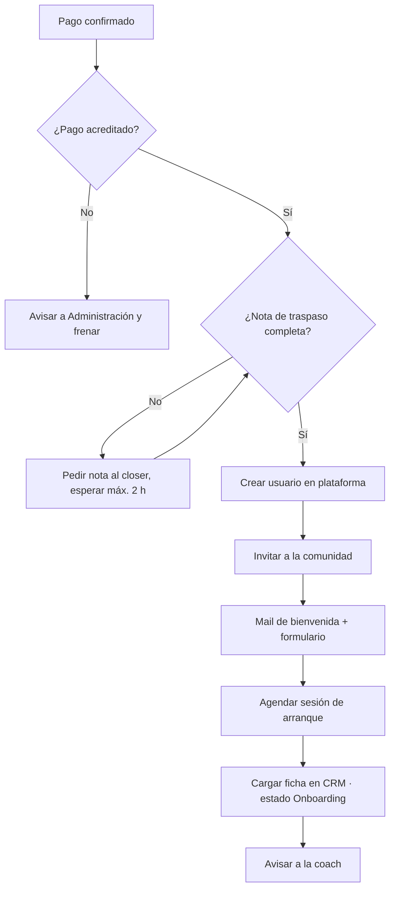

# Ejemplo de output · Constructor de SOP de Infonegocio

> Datos ficticios. Programa grupal de marketing para nutricionistas, 6 meses, vendido por llamada. El SOP sale después de una entrevista de 8 preguntas.

---

# SOP · Onboarding de alumno nuevo (del pago al primer acceso)

**Dueño:** Coordinación de servicio · **Se dispara cuando:** la pasarela confirma el primer pago (o administración confirma una transferencia) · **Frecuencia:** por evento (8 a 12 veces por mes) · **Duración estimada:** 25 minutos · **Herramientas:** CRM (Airtable), plataforma de cursos, comunidad (Circle), calendario de sesiones, mail · **Última actualización:** 14/10

## Objetivo

Este SOP describe cómo dar de alta a un alumno nuevo para que tenga acceso, formulario de inicio y primera sesión agendada **dentro de las 24 horas** del pago.

## Antes de empezar

- Acceso de administración a la plataforma de cursos y a la comunidad.
- Permiso de edición en la tabla **Alumnos** del CRM.
- La **nota de traspaso** del closer cargada en la oportunidad ganada (qué compró, cuotas pactadas, qué se le prometió en la llamada).

## Los pasos

1. **Abrí** el CRM, vista **Ventas ganadas sin onboarding**, y elegí la venta más antigua.
2. **Verificá** que el pago figure como acreditado en la tabla **Cobros**.
   - Si es transferencia sin comprobante → escribile a Administración por el canal #cobros y frená acá hasta que confirme.
3. **Leé** la nota de traspaso del closer. Si está vacía → escribile al closer por #ventas y esperá máximo 2 horas antes de seguir.
4. **Creá** el usuario en la plataforma de cursos con el mail del alumno y asignale el programa "Cohorte vigente".
5. **Invitá** al alumno a la comunidad, al grupo de su cohorte.
6. **Mandá** el mail de bienvenida con la plantilla "Bienvenida + formulario de inicio".
7. **Agendá** la sesión de arranque en el calendario de la coach asignada, dentro de los próximos 7 días.
8. **Cargá** en la tabla **Alumnos**: fecha de alta, coach asignada, fecha de sesión de arranque y estado = **Onboarding**.
9. **Avisale** a la coach por #servicio con el link a la ficha del alumno.

## Cuando algo sale mal

| Si pasa esto | Hacé esto | Avisale a |
|---|---|---|
| El pago no figura acreditado después de 24 h | No des acceso. Marcá la venta como "Pago pendiente". | Administración y el closer |
| El alumno no completa el formulario en 72 h | Mandá el recordatorio con la plantilla "Formulario pendiente". Si a los 5 días sigue sin hacerlo, llamalo. | Coach asignada |
| El mail rebota | Verificá el mail en la nota de traspaso y en la grabación de la llamada. Si sigue fallando, escribile por WhatsApp. | Closer |
| No hay coach con lugar en los próximos 7 días | Agendá con la coach que tenga lugar más pronto y marcá "Reasignar" en la ficha. | Head coach |
| El alumno compró un upgrade que no existe en la plataforma | No improvises accesos. Dejalo en "Onboarding" y consultá. | Founder |

## Cómo sabés que salió bien

- El alumno tiene acceso a la plataforma y a la comunidad **en menos de 24 h** desde el pago.
- La sesión de arranque está agendada **en los próximos 7 días**.
- La ficha del alumno tiene coach, fecha de alta y estado = Onboarding.
- La coach confirmó con un ✅ en #servicio que vio la ficha.

## Diagrama de flujo

Para pegarlo en Notion: escribí `/code`, elegí **Mermaid** y pegá el bloque.

## Lo que cambiaría

1. Los pasos 4, 5 y 6 son siempre iguales: son candidatos a automatizar (venta ganada → alta en plataforma + comunidad + mail). Ver skill Diseñador de Automatizaciones.
2. La nota de traspaso hoy depende de que el closer se acuerde. Conviene que sea un campo obligatorio para pasar la oportunidad a "Ganada".
3. Medir cada mes el tiempo real del pago al primer acceso: hoy nadie lo sabe.

---

¿Querés también la checklist corta para quien lo ejecuta, o la versión para pegar en Notion? Y la prueba de fuego: dáselo a alguien que no hace este proceso y pedile que lo siga. Cada duda es un paso mal escrito.
