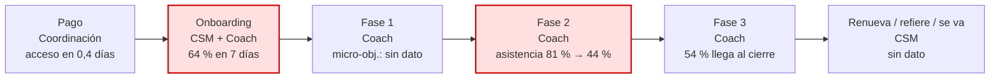

# Ejemplo de output · Journey de Servicio por Fases

> Datos ficticios. Mentoría grupal de 4 meses (120 días) para fisioterapeutas que quieren vender un programa online propio, USD 2.200 en 3 cuotas, vendida por llamada. Entregables: curso grabado, sesión grupal semanal, 3 sesiones 1 a 1, plantillas y comunidad. Roles: founder, 2 coaches, 1 CSM y 1 coordinación (cobra las cuotas). Base de alumnos en Airtable desde enero. Se gestiona en Asana. Hay 2 casos de éxito documentados.

---

# Journey del cliente · Mentoría "Tu programa online" · Mentoría para fisioterapeutas

**Estado: VALIDADO** con el founder el 05/10 (punto B, fases y micro-objetivos confirmados en una llamada de 30 min).

## 1. Lo que dicen los datos hoy

**Período:** del 08/01 al 30/09 (los 3 grupos que ya terminaron, 96 alumnos).

| Etapa del cliente | Métrica | Valor |
|---|---|---|
| Pago acreditado → acceso | Días hasta el acceso | 0,4 días (automático) |
| Onboarding completo | Llamada de onboarding hecha en 7 días | 61 de 96 (64 %) |
| Avance mes 1 | Micro-objetivo del mes 1 | sin dato (no se registra) |
| Asistencia | Asistencia a grupales, semana 2 → semana 6 | 81 % → 44 % |
| Cuotas | Cuota 3 pagada | 84 de 96 (88 %) |
| Termina | Llegó a la sesión 1 a 1 de cierre | 52 de 96 (54 %) |
| Renueva / refiere / se va | Bajas con motivo · renovaciones · referidos | **sin dato**: no se registra quién se fue, quién renovó ni quién refirió |

**Hoy no se puede saber cuántos se van ni cuántos renuevan.** Se propone el campo **Estado de salida** (Finalizado · Renovó · Baja con motivo) y el campo **Micro-objetivo del mes** (Sí · No · Parcial).

Campo revisado antes de usarlo: "Asistencia" la cargan las dos coaches igual (la toma el bot de Zoom). Sí se puede usar.

**Los dos puntos de caída**

1. **Onboarding: 1 de cada 3 no tiene la llamada en la primera semana.**
   - Hipótesis: la llamada se agenda a mano y el alumno elige fecha; los que compran en viernes la dejan para "la semana que viene".
   - Evidencia: de los 35 sin llamada en 7 días, 22 compraron jueves o viernes. CSM: *"me dicen 'te escribo el lunes' y no escriben"*.
2. **Entre la semana 2 y la 6 la asistencia cae a la mitad.**
   - Hipótesis: el primer entregable grande (la oferta) llega en la semana 8 y no hay nada intermedio; quien se atrasa deja de venir.
   - Evidencia: frase repetida en la comunidad: *"voy atrasada, me pongo al día y vuelvo"*. De los 44 que no llegaron al cierre, 37 dejaron de asistir antes de la semana 7.

**Quiénes terminan pronto:** 31 alumnos del grupo de julio terminan entre el 01/11 y el 15/11. Sin offboarding ni renovación definidos, es lo primero.

## 2. Promesa, punto A y punto B

- **Promesa:** en 4 meses tenés tu programa online armado, con precio y tus primeros alumnos.
- **Punto A** (llamadas y formularios): *"Atiendo 40 pacientes por semana, no me da el cuerpo y no sé cómo empaquetar lo que sé"*. Agenda llena, ingreso atado a las horas, miedo a "vender humo".
- **Punto B** (los 2 casos de éxito): programa de 8 semanas lanzado, 5 a 9 alumnos en la primera cohorte, 10 horas menos de consultorio por semana, *"por primera vez gano sin estar en la camilla"*.

## 3. La metodología y los pilares

**Ordenar → Empaquetar → Vender.** Primero se libera tiempo, después se convierte lo que sabe en una oferta, y se vende a su comunidad con la mentoría al lado.

Pilares (transversales, no son fases): *cuerpo antes que agenda* (no se suma trabajo sin sacar trabajo) y *vender es cuidar* (vender desde el diagnóstico, no desde la presión).

## 4. Las fases

4 meses → **3 fases** (regla: 4 solo con 6 meses o más). Reparto: 1 · 1,5 · 1,5 meses.

| Fase | Micro-transformación | Entregables | Terminado cuando | Duración | Micro-objetivos |
|---|---|---|---|---|---|
| 1 · Tu agenda con aire | De "no tengo tiempo" a 5 h por semana bloqueadas | Módulos 1 y 2 · 1 a 1 de arranque · plantilla de agenda | 5 h semanales bloqueadas dos semanas seguidas y tema elegido | Mes 1 | Mes 1: agenda bloqueada y tema elegido |
| 2 · Tu programa en una página | De "sé mucho" a una oferta con precio | Módulos 3 y 4 · plantilla de oferta · **borrador corto en la semana 5** [nuevo] · revisión de la coach | Offer doc aprobado por la coach | Semanas 5 a 10 | Mes 2: borrador entregado · semana 10: oferta aprobada |
| 3 · Tus primeros alumnos | De oferta a ventas | Módulo 5 · guion de conversación · 1 a 1 de práctica · 1 a 1 de cierre | 5 conversaciones de venta hechas | Semanas 11 a 17 | Mes 3: 5 conversaciones · mes 4: primera venta |

El borrador de la semana 5 ataca el punto de caída 2: un entregable chico antes de la semana 8.

**Variaciones dentro de las fases:** quien ya tiene comunidad grande acorta la fase 3; quien trabaja en relación de dependencia arranca la fase 1 con 3 horas en vez de 5.

## 5. Compromisos del cliente

| Cuándo | Se compromete a | Dónde se dice |
|---|---|---|
| Todas las fases | 5 h por semana · 3 de cada 4 grupales · avisar si se ausenta más de una semana | El closer en la venta y la coach en el onboarding |
| Fase 1 | Formulario de inicio antes de la llamada de onboarding | Mail de bienvenida |
| Fase 2 | Borrador en la semana 5, aunque esté incompleto | Llamada de onboarding |
| Fase 3 | Hacer las conversaciones, no solo prepararlas | 1 a 1 de práctica |

## 6. Onboarding D0 a D7

| Día | Qué pasa | Quién |
|---|---|---|
| D0 | Pago acreditado → mail de bienvenida con video del founder, accesos, formulario de inicio, mapa visual y **link para agendar la llamada con fecha límite D5** | Automatización + CSM |
| D1 | Alta en la comunidad y aviso a la coach con la ficha del cliente y las notas del closer | CSM |
| D2 | Check: formulario completo y llamada agendada | CSM |
| D3-D5 | Llamada de onboarding de 30 min | Coach |
| D7 | Check: entró al curso, está en la comunidad, tiene la primera grupal y las 3 sesiones 1 a 1 en el calendario | CSM |
| D20 | Mensaje de referidos ("¿conocés a alguien que esté como estabas vos?") | CSM |

Guion de la llamada: bienvenida y por qué compró → contexto personal (*"¿qué más tenés en tu vida estos 4 meses?"*) → el formulario en voz alta → el mapa y el micro-objetivo del mes 1 con fecha → plataformas al final.

## 7. Puntos de control, alertas y encuestas

| Cuándo | Qué se mira | En riesgo si | Qué se hace | Quién |
|---|---|---|---|---|
| D5 | Llamada de onboarding | No la agendó | Llamada de la CSM con dos horarios propuestos | CSM |
| Cada lunes (rutina del equipo, sobre la vista "2 faltas seguidas" de la base) | Asistencia | Faltó a 2 grupales seguidas | Mensaje de la coach; a la tercera, semáforo rojo y aviso al founder | Coach |
| D30 | Micro-objetivo del mes 1 | Sin agenda bloqueada | Sesión extra de 20 min y semáforo amarillo | Coach |
| D35 | Borrador de oferta | No lo entregó | Mensaje + revisión en vivo del borrador a medias | Coach |
| D60 | Encuesta de mitad (nota 1-10 por entregable + abierta + "¿qué te falta?" + NPS) | Nota de 6 o menos en algún entregable | Llamada de la CSM en 48 h | CSM |
| D30, D60 | Cuotas 2 y 3 | Vencida 5 días | Aviso de coordinación; la coach pausa las 1 a 1 con un mensaje neutro (la coach no cobra) | Coordinación |
| D100 | Encuesta final + NPS + permiso de caso | — | Los de 9 y 10, invitados a testimonio | CSM |
| Mensual | Retrospectiva grupal de 60 min | — | Casos de éxito, espacio de apoyo, compromisos | Coach |

**Las dos encuestas, listas para Google Forms:** se pegan los textos de la referencia (sección 4b) con estos cambios: entregables = curso grabado, sesión grupal semanal, 1 a 1 mensual, plantillas, comunidad; objetivo = "lanzar tu programa online"; punto A de la final = "atendías todo en el consultorio y no tenías programa". Recopilar mails verificados, respuestas en una planilla separada de la comercial y formato condicional en rojo para notas de 6 o menos.

## 8. Offboarding y renovación

- **D100:** encuesta final (antes de la última semana, no después).
- **D105:** 1 a 1 de cierre: qué logró contra su punto A. Si llegó al punto B, pedido de testimonio y referidos con permiso por escrito.
- **D110:** propuesta del programa de continuidad "Escalá tu programa" (existe, 3 meses) a quien terminó la fase 3. Para armar la oferta: skill **Retención, Upsells y LTV**.
- **D120:** mail de salida (accesos, salida de la comunidad, pedido de feedback) y **Estado de salida** en el CRM: Finalizado, Renovó o Baja con motivo.

## 9. Lo que ve el cliente

> **Mes 1 · Tu agenda con aire** → 5 horas por semana para tu proyecto y el tema de tu programa elegido.
> **Meses 2 y 3 · Tu programa en una página** → tu oferta con precio, aprobada.
> **Meses 3 y 4 · Tus primeros alumnos** → 5 conversaciones de venta y tu primera venta.
> Todo el camino: una grupal por semana, 3 sesiones 1 a 1 y la comunidad. Vos ponés 5 horas por semana.

## 10. El mapa en una vista y tres acciones



| # | Acción | Impacto | Esfuerzo | Responsable |
|---|---|---|---|---|
| 1 | Link de agenda en el mail del D0 con fecha límite D5 y llamada de la CSM si no agendó | Alto | Bajo | CSM |
| 2 | Borrador corto de oferta en la semana 5 con devolución en 72 h | Alto | Medio | Coach |
| 3 | Campos Estado de salida y Micro-objetivo del mes en el CRM | Medio | Bajo | Coordinación |

## 11. Validar con el founder

No aplica: validado el 05/10.

## 12. CSV para importar

```csv
Name,Section/Column,Description,Priority,Día relativo,Responsable,Recurrencia
"Renombrar proyecto: 'Mentoría · [Cliente] · 120 días'",Setup al duplicar,"D0 = fecha del pago acreditado.",High,D0,CSM,
"Cargar datos del cliente desde el CRM",Setup al duplicar,"Link a la ficha, coach asignada, notas del closer. Sin datos de pago en el gestor.",High,D0,CSM,
"Recalcular fechas desde D0",Setup al duplicar,"Las fechas de la plantilla son relativas.",Medium,D0,CSM,
"[AUTO] Mail de bienvenida con video, accesos, formulario, mapa y link de agenda",Fase 1 · Tu agenda con aire,"Verificar que salió. Si no salió en 2 h, mandarlo a mano. SOP: Onboarding de alumno nuevo.",High,D0,CSM,
"[HUMANA] Alta en la comunidad y aviso a la coach",Fase 1 · Tu agenda con aire,"Con la ficha y las notas del closer. SOP: Onboarding de alumno nuevo.",High,D1,CSM,
"[CHECK] Formulario completo y llamada agendada",Fase 1 · Tu agenda con aire,"Terminado cuando las dos cosas están en el CRM.",High,D2,CSM,
"[ALERTA] Sin llamada agendada al D5",Fase 1 · Tu agenda con aire,"Llamar con dos horarios propuestos. Registrar en el CRM.",High,D5,CSM,
"[HUMANA] Llamada de onboarding 30 min",Fase 1 · Tu agenda con aire,"Bienvenida, contexto, formulario en voz alta, micro-objetivo del mes 1 con fecha, plataformas al final. SOP pendiente.",High,D3-D5,Coach,
"[CHECK] Curso, comunidad, grupal y 3 sesiones 1 a 1 en el calendario",Fase 1 · Tu agenda con aire,"Si falta algo, mensaje de la CSM.",High,D7,CSM,
"[ALERTA] Si aparece en la vista '2 faltas seguidas': mensaje de la coach",Fase 1 · Tu agenda con aire,"La vista la revisa la coach cada lunes (rutina del equipo, no tarea por cliente). A la tercera falta: semáforo rojo y aviso al founder.",Medium,D7-D119,Coach,
"[HUMANA] Mensaje de referidos",Fase 1 · Tu agenda con aire,"Plantilla de referidos. SOP pendiente.",Low,D20,CSM,
"[CHECK] Micro-objetivo del mes 1",Fase 1 · Tu agenda con aire,"Agenda bloqueada dos semanas y tema elegido. Si no: semáforo amarillo y sesión extra de 20 min. Cargar Sí/No/Parcial en el CRM.",High,D30,Coach,
"[CHECK] Cuota 2 cobrada",Fase 1 · Tu agenda con aire,"Si vence 5 días: aviso de coordinación; la coach pausa las 1 a 1 con mensaje neutro.",High,D30,Coordinación,
"[CHECK] Borrador de oferta entregado",Fase 2 · Tu programa en una página,"Si no: revisión en vivo del borrador a medias. SOP pendiente.",High,D35,Coach,
"[HUMANA] Retrospectiva mensual 1 de 4",Fase 1 · Tu agenda con aire,"Casos de éxito, apoyo, compromisos. 60 min.",Medium,D30,Coach,"mensual · una fila por cada una"
"[HUMANA] Retrospectiva mensual 2 de 4",Fase 2 · Tu programa en una página,"Casos de éxito, apoyo, compromisos. 60 min.",Medium,D60,Coach,"mensual · una fila por cada una"
"[HUMANA] Retrospectiva mensual 3 de 4",Fase 3 · Tus primeros alumnos,"Casos de éxito, apoyo, compromisos. 60 min.",Medium,D90,Coach,"mensual · una fila por cada una"
"[HUMANA] Retrospectiva mensual 4 de 4",Offboarding y renovación,"Casos de éxito, apoyo, compromisos. 60 min.",Medium,D118,Coach,"mensual · una fila por cada una"
"[HUMANA] Encuesta de mitad",Fase 2 · Tu programa en una página,"Nota 1-10 y abierta por entregable, '¿qué te falta?', NPS. Nota de 6 o menos: llamada en 48 h.",High,D60,CSM,
"[CHECK] Micro-objetivo del mes 2 y cuota 3",Fase 2 · Tu programa en una página,"Borrador entregado; cuota 3 cobrada.",High,D60,Coach,
"[CHECK] Oferta aprobada",Fase 2 · Tu programa en una página,"Si no: plan de recuperación de 2 semanas.",High,D70,Coach,
"[HUMANA] Sesión 1 a 1 de práctica de venta",Fase 3 · Tus primeros alumnos,"Role-play con el guion. SOP pendiente.",Medium,D75,Coach,
"[CHECK] Micro-objetivo del mes 3: 5 conversaciones",Fase 3 · Tus primeros alumnos,"Si no: semáforo rojo y aviso al founder.",High,D90,Coach,
"[HUMANA] Encuesta final + NPS + permiso de caso",Offboarding y renovación,"Antes de la última semana.",High,D100,CSM,
"[HUMANA] Sesión 1 a 1 de cierre",Offboarding y renovación,"Qué logró contra su punto A. Testimonio y referidos si llegó al punto B.",High,D105,Coach,
"[HUMANA] Propuesta de continuidad",Offboarding y renovación,"Solo a quien terminó la fase 3. Oferta: skill Retención, Upsells y LTV.",Medium,D110,CSM,
"[HUMANA] Mail de salida y Estado de salida en el CRM",Offboarding y renovación,"Accesos, salida de la comunidad, feedback. Finalizado / Renovó / Baja con motivo.",High,D120,CSM,
```

Las retrospectivas van una fila por cada una porque son 4 (el corte es 6 repeticiones). El chequeo de asistencia **no está en la plantilla**: es una rutina del equipo (cada lunes, la coach mira en la base la vista "2 faltas seguidas" de todos los alumnos juntos); en la plantilla queda solo la alerta con lo que se hace con ese alumno. Si fueran 17 tareas semanales por alumno, con 30 alumnos serían 510 tareas.

## Para confirmar

Nada para confirmar: el journey está validado con el founder.

---

¿Querés que convierta las fases, los micro-objetivos y el estado de salida en campos del CRM de clientes? Para eso está la skill CRM de Cliente para Infonegocios. Y las tareas con "SOP pendiente" son tu lista de documentación: si la plantilla se usa sin esos SOPs, vuelve a depender de la memoria de alguien.
