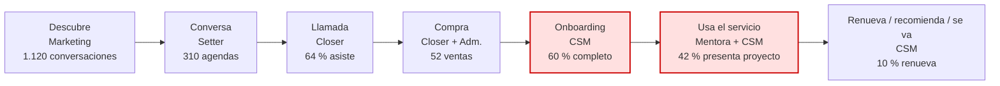

# Ejemplo de output · Mapa de Customer Journey de Infonegocio

> Datos ficticios. Mentoría grupal de 4 meses para diseñadoras y diseñadores freelance, USD 1.400 en 2 cuotas. Se vende por WhatsApp (setter) y llamada (closer). Datos de julio a septiembre.

---

# Customer Journey · Mentoría Estudio Propio · datos jul–sep

## 1. Las etapas

| Etapa | Qué hace el cliente | Canal | Responsable | Qué tiene que pasar para avanzar | Métrica | Valor (3 meses) |
|---|---|---|---|---|---|---|
| Descubre | Ve un reel o un video largo | Instagram, YouTube | Marketing | Escribe la palabra clave por DM | Conversaciones nuevas | 1.120 |
| Conversa | Responde las preguntas del setter | WhatsApp | Setter | Califica y acepta agendar | Agendas | 310 |
| Llamada | Tiene la llamada con el closer | Videollamada | Closer | Asiste | Asistidas | 198 (64 %) |
| Compra | Paga la primera cuota | Pasarela | Closer + administración | Pago acreditado | Ventas | 52 |
| Onboarding | Recibe accesos, completa el formulario, va a la primera clase | Mail, comunidad | CSM | Asiste a la primera clase en vivo | Onboarding completo en 7 días | 31 de 52 (60 %) |
| Usa el servicio | Va a clases, presenta avances | Comunidad, clases en vivo | Mentora + CSM | Presenta el primer proyecto (semana 6) | Presentaron proyecto | 22 de 52 (42 %) |
| Renueva, recomienda o se va | Paga la segunda cuota, refiere, renueva o se va | Pasarela, WhatsApp | CSM | Segunda cuota pagada · referido · renovación | Segunda cuota pagada | 44 de 52 (85 %) |
| | | | | | Referidos | sin dato |
| | | | | | Renovación al programa avanzado | 5 de 52 (10 %) |

## 2. Conversión entre etapas

```
Conversaciones 1.120 → Agendas 310 (28 %) → Asistidas 198 (64 %) → Ventas 52 (26 %)
→ Onboarding completo 31 (60 %) → Presentan proyecto 22 (71 % de los onboardeados · 42 % del total)
→ Renuevan 5 (10 %)
```

## 3. Los dos puntos de caída

**1. Onboarding: 4 de cada 10 no llegan a la primera clase en la primera semana**
- **Hipótesis:** la primera clase en vivo es los martes; quien compra un miércoles espera 6 días sin nada que hacer y se enfría.
- **Evidencia:** de los 21 que no completaron el onboarding, 15 compraron entre miércoles y viernes. CSM: "me escriben '¿cuándo empiezo?' y la respuesta es 'el martes que viene'".

**2. Entre el onboarding y el primer proyecto se va casi un tercio**
- **Hipótesis:** el primer proyecto (semana 6) es grande y no hay entregas intermedias; la gente se atrasa y deja de venir.
- **Evidencia:** asistencia a clases en vivo: 78 % en la semana 2, 39 % en la semana 5. Frase repetida en la comunidad: "voy atrasada, me pongo al día y vuelvo".

*Nota:* la renovación (10 %) es baja, pero quien presenta el proyecto renueva 5 de 22 (23 %) y quien no lo presenta, 0 de 30. Arreglar el punto 2 es también arreglar la renovación.

## 4. Convención de UTMs y dónde se registra

| Parámetro | Valores | Ejemplo |
|---|---|---|
| utm_source | instagram · youtube · whatsapp | instagram |
| utm_medium | organico · bio · pauta · email | bio |
| utm_campaign | nombre de la campaña o lanzamiento | portfolio-octubre |
| utm_content | nombre de la pieza | reel-cliente-que-no-paga |

- Va en el link de la bio, en cada video de YouTube y en cada anuncio.
- El setter carga **canal de origen** en el CRM al crear la conversación. Sin canal, no se puede pasar a Agenda.
- Hoy: 23 % de las ventas sin canal. Meta en 2 meses: menos de 5 %.

## 5. El mapa en una vista



## 6. Tres acciones

| # | Acción | Impacto | Esfuerzo | Responsable |
|---|---|---|---|---|
| 1 | Clase de bienvenida grabada + primera tarea de 30 minutos que se habilita apenas paga | Alto | Bajo | CSM |
| 2 | Partir el primer proyecto en 2 entregas (semana 3 y semana 6) con devolución corta | Alto | Medio | Mentora |
| 3 | Alerta para la CSM cuando alguien falta a 2 clases seguidas, con mensaje de "te ayudo a ponerte al día" | Medio | Bajo | CSM (la alerta la arma operaciones) |

---

¿Querés la versión visual para Miro, FigJam o Notion? El bloque Mermaid se pega en Notion con `/code` → Mermaid.
